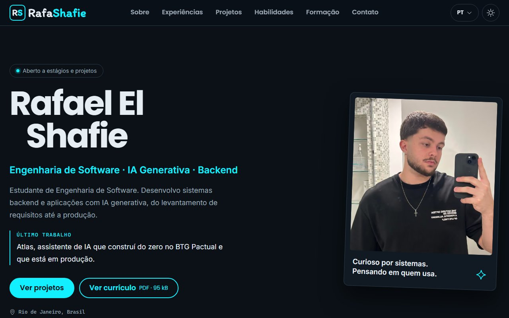
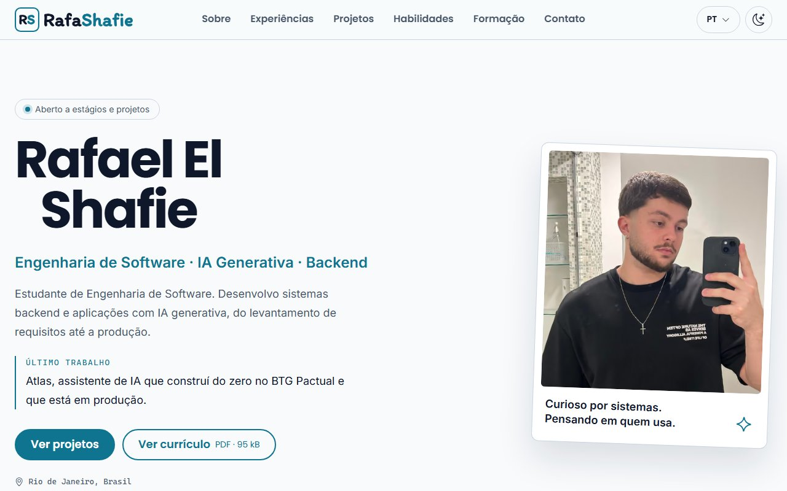
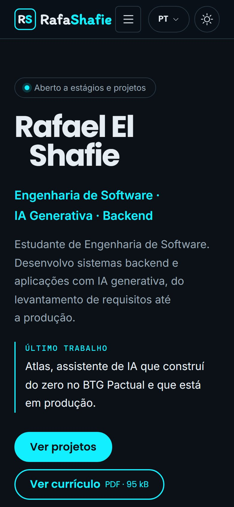
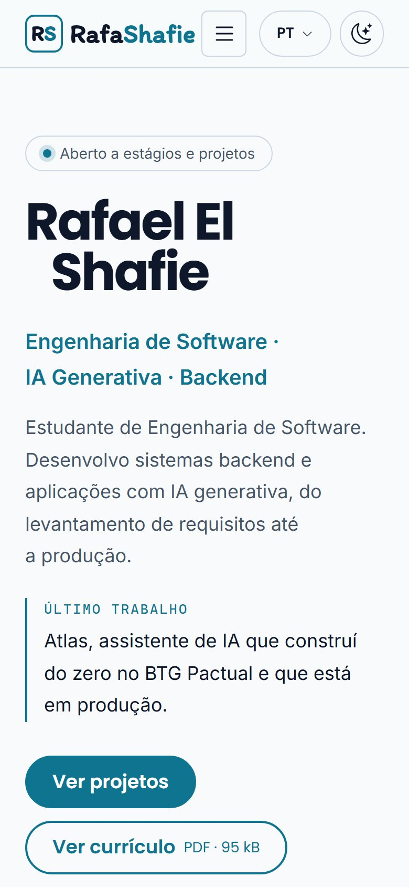
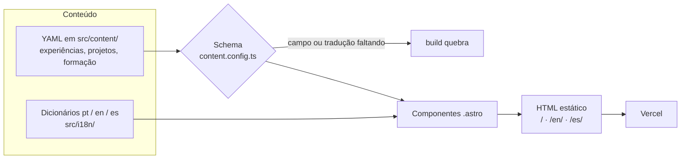
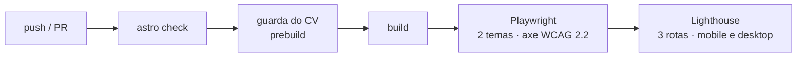

# Rafael El Shafie: portfólio

Site pessoal de um estudante de Engenharia de Software focado em **backend e IA generativa**. Tem versões em português, inglês e espanhol, tema claro e escuro, e nota 100 em Acessibilidade, Boas práticas e SEO, e 99 ou mais em Performance no Lighthouse.

**Engenharia de Software · IA Generativa · Backend**

**Site:** [rafashafie.site](https://www.rafashafie.site) · [English](https://www.rafashafie.site/en/) · [Español](https://www.rafashafie.site/es/)

| Escuro | Claro |
|---|---|
|  |  |

<p align="center">
  
  &nbsp;
  
</p>

## O que tem no site

- **Experiências** em acordeão, cada uma com um modal "Explorar a experiência" que conta o problema, as decisões e o que aprendi.
- **Projetos** com filtros por área (IA, Backend, Dados, Frontend). Os trabalhos principais têm destaque, e cada card mostra o estágio real do projeto.
- **Modais com resumo no topo** (problema, participação, entrega e resultado) e **diagramas ilustrativos** nos projetos principais.
- **Link direto para cada modal** (`/#project-atlas`) e links entre a experiência e o projeto correspondente.
- **Habilidades em abas**, com o contexto em que cada uma foi usada.
- **Contato:** o cartão de e-mail abre o app de e-mail, e um botão ao lado copia o endereço. O currículo é o do idioma da página.

## Por que reescrever

O site antigo (HTML e CSS puros, guardado na tag [`v0-legado`](https://github.com/Rafa-Shafie/portfolio/tree/v0-legado)) estava desatualizado e tinha bugs visíveis:

- um `li>` solto no menu;
- o menu de desktop aparecendo no celular;
- um link que levava a uma seção comentada.

Uma [auditoria](docs/AUDITORIA-PORTFOLIO.md) mostrou que o código não era um ativo: sem variáveis CSS, com textos fixos, tamanhos em `vh`, contraste reprovado e sem Git. Os requisitos novos (tema, três idiomas, conteúdo como dados) mexeriam em quase todas as linhas. Por isso, a decisão foi reescrever, aproveitando o conteúdo e a identidade visual (preto e ciano).

### Antes e depois (Lighthouse 13.5.0)

| | Performance | Acessibilidade | Boas práticas | SEO |
|---|---|---|---|---|
| v0-legado, mobile | 75 | 70 | 92 | 91 |
| v0-legado, desktop | 99 | 70 | 96 | 91 |
| **v1, mobile** | **100** | **100** | **100** | **100** |
| **v1, desktop** | **100** | **100** | **100** | **100** |

A tabela registra o lançamento do v1. Depois, o texto corrido passou a usar a Inter, mais confortável em parágrafos longos (a Poppins segue nos títulos e botões): a Performance no celular ficou em torno de 99, uma troca medida antes e depois.

Os relatórios completos e o método estão em [docs/lighthouse/](docs/lighthouse/). O CI mede de novo a cada push e falha se alguma nota ficar abaixo do mínimo (90 em Performance e 100 nas outras).

## Stack

- **[Astro](https://astro.build/)** com saída estática: zero JavaScript por padrão, um HTML por idioma, content collections e i18n nativos.
- **TypeScript** nos dicionários e no conteúdo: faltou um campo ou uma tradução, o build quebra.
- **CSS puro com design tokens**, `<style>` escopado por componente e nenhum framework de CSS. Recursos nativos onde eles bastam: `light-dark()`, container queries, `@starting-style` e a View Transitions API.
- **Fontes self-hosted** pela fonts API do Astro, só o subset latin: Poppins nos títulos e botões, Inter no texto corrido. A marca (RS + RafaShafie) é um SVG gerado a partir da Itim.
- **Scripts pequenos em TS** para menu, idioma, tema, abas, filtros, modais e e-mail. Nada aqui justifica React.
- **Playwright + axe + Lighthouse** no GitHub Actions; deploy na **Vercel**, com preview por PR.

## Como funciona





```text
src/
├── content/      1 YAML por experiência, projeto e curso, validado por schema
├── data/         contatos, habilidades, tamanho do CV, regra dos rascunhos, detalhes dos modais
├── i18n/         dicionários tipados (pt define o tipo; en e es precisam ter as mesmas chaves)
├── components/   cabeçalho, seletores de idioma e tema, cartões, modais, diagramas e seções
├── layouts/      <head>: SEO, canonical, hreflang, Open Graph, JSON-LD e tema sem flash
├── pages/        as 3 rotas, a página 404, a imagem Open Graph de cada idioma e o robots.txt
└── styles/       tokens.css (cores em light-dark()) e global.css
tests/e2e/        suíte Playwright, que lê os mesmos YAML e dicionários do site
scripts/          marca em SVG, guarda do CV, Lighthouse com nota mínima, prints deste README
```

## Decisões

1. **Conteúdo como dados validados.** Adicionar um projeto é adicionar um YAML. Um campo ou tradução faltando quebra o build, não a produção. Os testes leem os mesmos arquivos, então conteúdo novo não exige mudar teste.
2. **O card diz o que já existe.** Projeto em planejamento ou em andamento precisa de uma linha de estágio (`stage`), exigida pelo schema, para o objetivo do produto não ser lido como funcionalidade pronta. Cada card mostra no máximo 5 tecnologias; a lista completa fica no modal.
3. **i18n por rota, gerado no build.** Cada idioma é um HTML próprio, indexável e sem texto trocando depois de carregar, com `hreflang`, canonical e imagem Open Graph por idioma.
4. **Tema com `light-dark()` e sem flash.** Cada cor é declarada uma vez e o `color-scheme` da raiz escolhe o tema. Sem escolha salva, quem decide é o sistema, mesmo sem JavaScript. Um script síncrono no `<head>` aplica a escolha salva antes da primeira pintura.
5. **Destaque diferente por tema.** O ciano `#12EFFF` tem 13,4:1 de contraste no escuro, mas ~1,4:1 sobre branco. No claro, o destaque é um ciano escuro (`#0E7490`, 5,1:1).
6. **Modais que dá para compartilhar.** Abrir um modal põe o id dele no endereço com `history.replaceState`, sem encher o histórico do botão Voltar. Quem chega por esse link já vê o modal aberto. Cada projeto referencia a sua experiência no YAML, e os dois modais ganham links um para o outro.
7. **Diagramas em HTML e CSS, não em imagem.** O texto é real: o leitor de tela lê, cada idioma tem o seu, e as cores seguem o tema. A regra de confidencialidade vale para eles: o diagrama só mostra o que o texto público já diz, sem prints, código ou números internos.
8. **Acessibilidade como requisito medido:**
   - regras automáticas da WCAG 2.2 A/AA conferidas pelo axe nos dois temas e nos três idiomas (testes automáticos cobrem parte dos critérios; a avaliação manual com leitor de tela ainda está por fazer);
   - padrões do W3C/APG: abas, disclosure, acordeão nativo e `<dialog>`;
   - teclado, foco visível e `prefers-reduced-motion`, que desliga todas as animações;
   - nenhuma rolagem horizontal de 320px até texto a 200%.
9. **Melhoria progressiva.** Sem JavaScript, nada quebra:
   - as abas viram blocos empilhados;
   - os filtros somem e todos os projetos aparecem;
   - o cartão de e-mail continua sendo o link `mailto`; só o botão de copiar some;
   - o tema segue o sistema.
10. **Um botão por cartão, com a área de clique esticada.** O cartão inteiro é clicável, mas só existe um botão de verdade. Envolver o cartão num botão faria o leitor de tela ler o cartão todo como nome do botão.
11. **Privacidade como guarda automática.** Os PDFs do currículo passam por uma verificação no `prebuild` que procura telefone em texto, marcadores, metadados e streams comprimidos. Como roda dentro do build, ela barra o deploy da Vercel, que não espera o CI.
12. **SEO além do básico.** As três páginas têm dados estruturados (`schema.org/Person`, com cargo no idioma e os perfis do LinkedIn e do GitHub). Endereços que não existem caem numa página 404 nos três idiomas, com `noindex` e fora do sitemap.
13. **Rascunhos só em preview.** Conteúdo com `draft: true` aparece no `npm run dev` e no preview da Vercel, nunca em produção.

## Rodar localmente

Requisito: Node 24 (ver `.nvmrc`).

```bash
npm install
npm run dev          # http://localhost:4321
```

| Comando | O que faz |
|---|---|
| `npm run build` | Guarda do CV + build estático em `dist/` |
| `npm run check` | `astro check` (tipos e templates) |
| `npm run test:e2e` | Build + testes Playwright nos dois temas (na primeira vez: `npx playwright install chromium`) |
| `npm run test:e2e:ui` | Testes no modo visual do Playwright |
| `npm run lighthouse` | Lighthouse nas 3 rotas, mobile e desktop, com nota mínima (precisa do build) |
| `npm run screenshots` | Regera os prints deste README (precisa do build) |
| `npm run brand` | Regera a marca (RS + RafaShafie) em SVG |

Para trocar o currículo, veja [docs/curriculo.md](docs/curriculo.md).
